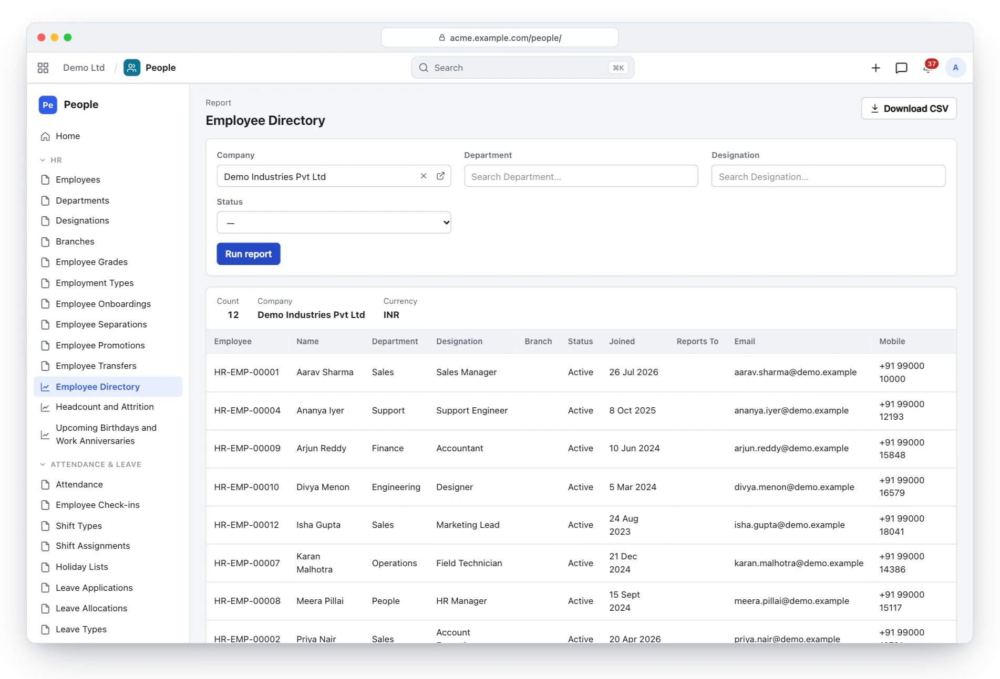
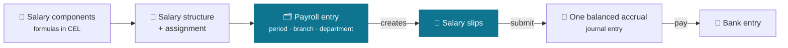
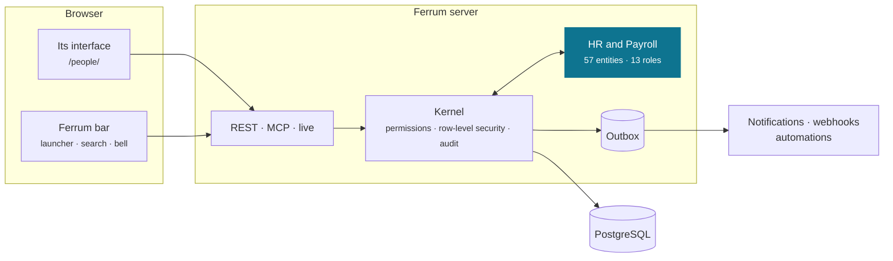
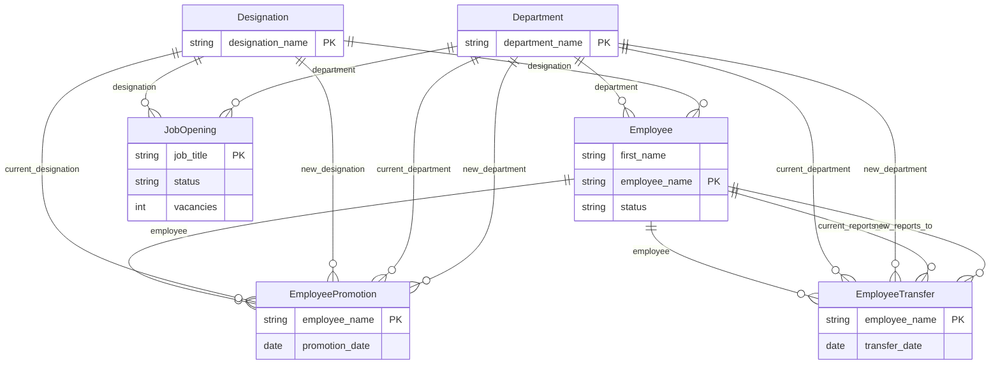

<div align="center">

<picture>
  <source media="(prefers-color-scheme: dark)" srcset="docs/assets/banner-dark.svg">
  
</picture>

[](https://github.com/CBFerrum/ferrum-app-hr/actions/workflows/ci.yml)      

**A native app for [Ferrum](https://github.com/CBFerrum/Ferrum), the open-source, AI-first business platform.**

[Overview](#overview) · [Highlights](#highlights) · [Screenshots](#screenshots) · [How it works](#how-it-works) · [Data model](#data-model) · [Install](#install) · [Develop](#develop) · [Changelog](#changelog)

</div>

---

## Overview

Ferrum HR and Payroll runs the employee lifecycle end to end: hiring, onboarding, shifts and
attendance, leave, expenses, appraisals, promotions and separation, and a payroll that computes
salary slips from formula-driven components, then posts one balanced accrual and pays by bank
entry. Employees get self-service access to what is theirs.


| At a glance | |
|---|---|
| 📦 Version | `0.3.4` |
| 🧱 Platform | Ferrum `>=0.3.2, <0.4` |
| 🔗 Requires | nothing else |
| 🖥️ Interface | its own, at `/people/` |
| 🗃️ Records | 57 entities in 4 packages |
| 👥 Roles | 13: HR Manager, HR User, Employee, Leave Approver, Attendance Device, HR Manager … |
| 📊 Reports | 11 |
| 🧪 Tests | 20 Rust tests, 1 interface test file |


## Highlights

<table>
<tr>
<td width="50%" valign="top">

### 🏢 Organization
Departments, designations, branches and grades; employees with reporting lines and self-service.

</td>
<td width="50%" valign="top">

### 🕘 Shifts and attendance
Holiday lists, shifts, device check-ins and attendance with late entries, early exits and half days.

</td>
</tr>
<tr>
<td width="50%" valign="top">

### 🌴 Leave
Types and policies, allocations, approvals, a leave ledger, encashment and carry forward.

</td>
<td width="50%" valign="top">

### 🤝 Recruitment to separation
Openings, applicants, interviews and offers; onboarding, appraisals, promotions, transfers and exits.

</td>
</tr>
<tr>
<td width="50%" valign="top">

### 💸 Payroll
Components with formulas (CEL), structures, tax slabs and declarations; slips, accrual and bank payment.

</td>
<td width="50%" valign="top">

### 📊 Eleven reports
From the monthly attendance sheet to the salary register and bank remittance.

</td>
</tr>
</table>

## Screenshots

<picture>
  <source media="(prefers-color-scheme: dark)" srcset="docs/assets/hr-dark.webp">
  
</picture>

<p align="center"><sub>The employee directory: people by department and designation.</sub></p>

> [!TIP]
> The screenshots follow your GitHub theme: switch between light and dark to see both.

## How it works

### Payroll, from components to the bank



### Inside Ferrum



Everything HR and Payroll adds is ordinary Ferrum metadata and Rust: its records get lists, forms,
search, permissions, an audit trail, exports and the REST and MCP APIs for free, so AI agents work
with them under the same rules as people.

### What it adds to Ferrum

| Where | What |
|---|---|
| 🚀 Launcher | **People** at `/people/` |
| ➕ Create menu | Leave request |
| 🔔 Notification | Leave requests waiting for your approval |
| 🔔 Notification | Decisions on your leave requests |
| 🔔 Notification | Expense claims waiting for your approval |
| 🔔 Notification | Decisions on your expense claims |

## Data model

The main records and how they connect (57 entities in all; `packages/` has every field).



### Roles

| Role | What it is for | Entities |
|---|---|---|
| **HR Manager** | Everything in HR, including bank and identity details. | 30 |
| **HR User** | Day-to-day HR work; no bank details and no approvals. | 29 |
| **Employee** | Self-service; sees and creates only their own records (the employee whose user is the signed-in user). | 20 |
| **Leave Approver** | Approves or rejects the leave applications routed to them. | 5 |
| **Attendance Device** | For the API keys of biometric or RFID devices; they can only post check-ins. | 1 |
| **HR Manager** |  | 7 |
| **HR User** |  | 5 |
| **Employee** |  | 3 |
| **Expense Approver** | Sanctions, approves or rejects the expense claims routed to them. | 3 |
| **Payroll Manager** | Salary structures, payroll runs and payroll reports, including bank details. | 19 |
| **HR Manager** |  | 11 |
| **Employee** |  | 5 |
| **Payroll Manager** |  | 3 |

<details>
<summary><b>Reports (11)</b></summary>

- Employee Directory
- Headcount
- Employee Events
- Monthly Attendance Sheet
- Leave Balance
- Recruitment Pipeline
- Expense Claim Summary
- Salary Register
- Payroll Summary
- Bank Remittance
- Income Tax Deductions

</details>

## Install

Workspace administrators install it from **Apps** (`/store/`) in Ferrum; it ships in the
official Ferrum server image. Self-hosters building their own image enable the
`hr` feature of the server. Everything it adds is also available to AI agents over
Ferrum's MCP server, within each person's permissions.

## Develop

Clone it next to the platform:

```text
work/
├── ferrum/            https://github.com/CBFerrum/Ferrum (with Ferrum-Frontend cloned into ferrum/web)
└── ferrum-app-hr/
```

Point the platform dependencies at your checkout (this file is git-ignored):

```toml
# .cargo/config.toml
[patch."https://github.com/CBFerrum/Ferrum"]
ferrum-apps = { path = "../ferrum/crates/apps" }
ferrum-domain = { path = "../ferrum/crates/domain" }
ferrum-kernel = { path = "../ferrum/crates/kernel" }
ferrum-meta = { path = "../ferrum/crates/meta" }
```

The tests need PostgreSQL with an ordinary (non-superuser) role, so row-level security
applies:

```bash
createuser ferrum --pwprompt && createdb -O ferrum ferrum_hr_test
cargo test
```

`FERRUM_HR_TEST_DATABASE_URL` overrides the database URL.


The interface lives in `ui/` and builds with Ferrum-Frontend's packages:

```bash
cd ui
npm run build      # ui/dist, checked against the size budget
npm test
```

With a development server started with `FERRUM_DEV_UI=1`, `ferrum-app dev --ui` serves the pages
from Vite behind the real bar and session, with hot reload.


### Project layout

```text
app.yaml      the manifest: id, version, requirements, what it adds to Ferrum
packages/     metadata: entities, roles, reports, workflows, print formats
src/          the app's logic in Rust: hooks, actions, endpoints, upkeep jobs
ui/           its own interface (React + Vite), built into ui/dist
tests/        integration tests against a real PostgreSQL
CHANGELOG.md  what changed in each version
```

## Changelog

| Version | Highlights |
|---|---|
| **0.3.4** | The interface starts faster: its first download holds the frame and the app's own pages, and lists, forms, reports and other apps' screens load … |
| **0.3.3** | Record cards (the bar's previews on hover, Ferrum apps-ui.md U5) stay off your leave requests, the requests waiting for your approval and the … |
| **0.3.2** | Rebuilt with Ferrum-Frontend a8d4dda: under the platform's bar the records frame no longer shows a second bell (the bar has notifications). |
| **0.3.1** | Its notifications have kinds each person chooses for (Ferrum's bell, apps-ui.md U5): leave requests and expense claims waiting for your approval … |

Every version is in [CHANGELOG.md](CHANGELOG.md).

## License

[AGPL-3.0-only](LICENSE), like the platform. Part of [Ferrum](https://github.com/CBFerrum/Ferrum) ·
[Report an issue](https://github.com/CBFerrum/ferrum-app-hr/issues)
